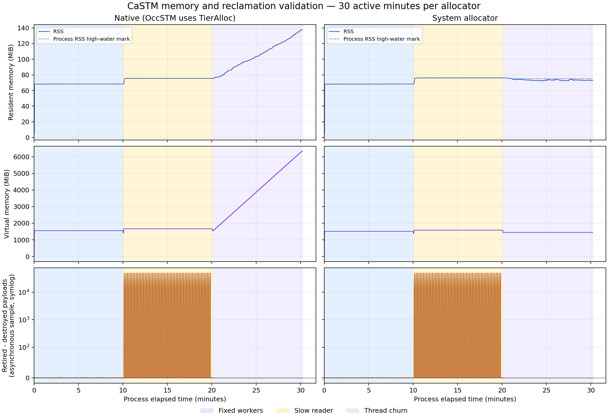

# OccSTM 长时内存与回收验证

记录日期：2026-11-04，分支 `codex/occ-memory-soak`。
两种分配路径各连续运行三个 10 分钟阶段，六阶段主负载合计 **60.00 分钟**。
全部阶段的 checksum、退休/回收和 payload 最终析构计数通过对账。慢读者持有
裸节点指针期间保护检查通过，释放后在恢复窗口内回收；每批 churn 结束也完成对账。

**回收计数通过与 allocator 内存保留是两个结论。**默认 TierAlloc 路径在线程 churn 阶段的虚拟内存窗口中位数增加约 4360.0 MiB，去掉该阶段最初 2 分钟后的拟合增长率约 479.8 MiB/分钟。这与线程退出时保留 slab/chunk 的实现策略一致，不能把本轮结果表述为默认分配器在线程 churn 下内存有界。

## 版本、来源与方法

- 精确验证提交：`92a2605b266679fff81e4519ff2e3f4ea5ed76c7`，运行时工作区干净。
- 生产 STM/EBR/TierAlloc 源码与基线 `e558c92` 一致；只增加独立验证目标、采样工具与记录。
- 环境：Intel(R) Core(TM) i5-14600KF，GCC 11.4.0，Linux-6.18.40.1-microsoft-standard-WSL2-x86_64-with-glibc2.35。
- Release，无 sanitizer、无 CPU 绑定；native 与 system 顺序运行，期间没有并行构建或测试。
- 开始：2026-11-04T13:08:54+08:00；结束：2026-11-04T14:11:18+08:00。上述 60 分钟为主负载，基线/收尾采样另计。
- 二进制 SHA-256：native `a48e45516fcfd49c787cca5fa66ab100229aff22cde5d2badce9363746840372`；system `e8d0990882d2ebc2e15bb03f6fde4fab505040f2fa5b8a8221afad0997849ef7`。

| 参数 | 设置 |
| --- | --- |
| 每条分配路径 | 一个连续进程，稳定线程、慢读者、线程 churn 各 600 秒 |
| 变量与事务 | 20 个独立变量，每线程独占一个；每次读取，交替只读与递增写入 |
| 稳定与慢读者 worker | 20 个，目标每线程 1,000 次事务/秒，等待发生在 guard 外 |
| 慢读者 | 额外 1 个，持有 guard 5 秒、恢复 5 秒，反复检查旧节点 |
| 线程 churn | 每 5 秒创建并退出 20 个 worker，每线程最多 2,000 次事务 |
| 内存采样 | 每秒及关键事件读取 /proc/self/status；KiB 转为 MiB |
| 资源上限 | RSS 1 GiB、VmSize 8 GiB；触发则提前停止并将结果标为无效 |

这套负载用于隔离生命周期行为，参数不同于 8 操作/事务的热点性能实验，不用于
给出新的吞吐优化比。每变量只有一个写者，每次写入超过 MAX_HISTORY=8 后恰好
退休一个版本。预期退休数可精确计算，所有阶段都真实经过 OccSTM 提交、剪枝和 EBR。

计数对象是每版本独立的 shared_ptr payload 探针，不是生产 VersionNode 的全局
分配计数。正常 EBR 回收触发探针析构；变量销毁时保留链的析构单独记录。事务
临时引用在 guard 退出前释放，慢读者只保留裸节点和独立析构标志。

## 对账结果

| 分配路径 | 阶段 | 成功写入 / checksum | 预期退休 / 已回收 | 已析构 / 已创建探针 | checksum |
| --- | --- | ---: | ---: | ---: | --- |
| native | 稳定线程 | 5,999,692 | 5,999,532 / 5,999,532 | 5,999,712 / 5,999,712 | 匹配 |
| native | 慢读者 | 5,999,251 | 5,999,091 / 5,999,091 | 5,999,271 / 5,999,271 | 匹配 |
| native | 线程反复创建退出 | 2,400,000 | 2,399,840 / 2,399,840 | 2,400,020 / 2,400,020 | 匹配 |
| system | 稳定线程 | 5,999,765 | 5,999,605 / 5,999,605 | 5,999,785 / 5,999,785 | 匹配 |
| system | 慢读者 | 5,998,889 | 5,998,729 / 5,998,729 | 5,998,909 / 5,998,909 | 匹配 |
| system | 线程反复创建退出 | 2,400,000 | 2,399,840 / 2,399,840 | 2,400,020 / 2,400,020 | 匹配 |

每阶段线程全部退出后，推进 16 次 epoch，再验证 checksum、退休回收计数与保留
链。每变量最多保留 9 个版本，本轮每阶段销毁前均为 180 个存活探针；变量销毁
并再次推进 epoch 后，存活和待回收计数均为零。没有未发布探针或校验错误记录。

## RSS 与虚拟内存

表内“初期/末期”为该阶段最初/最后 60 秒常规采样的中位数，峰值为该阶段采样
到的 RSS 最大值。末期窗口包含短暂收尾；原始事件可区分工作期、drain 与销毁。
VmHWM 是进程累计峰值，另保存在 CSV，不将它当作单阶段峰值。

| 分配路径 | 阶段 | 初期 → 末期 RSS（MiB） | 采样 RSS 峰值（MiB） | 初期 → 末期 VmSize（MiB） |
| --- | --- | ---: | ---: | ---: |
| native | 稳定线程 | 68.20 → 68.33 | 68.34 | 1552.08 → 1552.08 |
| native | 慢读者 | 75.42 → 75.50 | 75.50 | 1664.09 → 1664.09 |
| native | 线程反复创建退出 | 76.96 → 134.48 | 137.62 | 1768.02 → 6128.02 |
| system | 稳定线程 | 68.07 → 68.27 | 68.34 | 1510.06 → 1510.06 |
| system | 慢读者 | 76.00 → 76.14 | 76.14 | 1582.06 → 1582.06 |
| system | 线程反复创建退出 | 75.82 → 72.86 | 76.01 | 1446.00 → 1446.00 |

背景依次标记三个阶段；第三行是异步快照中“预期退休数减已析构数”的差值，使用
symlog 显示。活跃期的独立原子计数不构成同一时刻的严格快照，瞬时小负值或小差值
不能当作队列不变量；只有 quiescent 行用于严格对账。

## 慢读者

| 分配路径 | 持有轮次 | guard 内保护通过 | 释放后回收通过 | 采样积压峰值 | 回收延迟中位 / 最大（ms） |
| --- | ---: | ---: | ---: | ---: | ---: |
| native | 59 | 59 | 59 | 50,015 | 3.767 / 4.935 |
| system | 59 | 59 | 59 | 50,018 | 4.404 / 6.520 |

每轮保留当时 head 的裸指针。持有结束时要求该 key 至少完成后续 9 次写入，确认
旧版本已离开保留链；其独立析构标志仍未置位，payload 的值与校验字段保持正确。
guard 释放后主动推进 epoch，要求析构标志在 5 秒恢复窗口内置位。表中的延迟
包含主动 drain 与 1 ms 轮询，仅表示这组验证条件下的恢复时间，不是生产延迟保证。

## 线程创建退出与分配器保留

| 分配路径 | 批次 | 新建/退出 worker 总数 | 去掉最初 2 分钟后的 VmSize 拟合斜率（MiB/分钟） |
| --- | ---: | ---: | ---: |
| native | 120 | 2,400 | 479.84 |
| system | 120 | 2,400 | 0.00 |

每批线程全部退出后核对 checksum、退休/回收数和保留版本数。全部 payload 最终
析构，支持本次负载下的对象回收结论；allocator 还持有多少 chunk 不由这些计数
直接衡量。

TierAlloc 的 [SizeClassPool 析构](../../src/TierAlloc/ThreadHeap/SizeClassPool.cpp)
为避免活对象所在 chunk 提前归还，在线程退出时断开本地链表并保留 chunk；单块
大小为 2 MiB。上述增长与该策略一致，但没有额外 chunk 计数，不能把每个字节
的 VmSize 差异都归因于 TierAlloc；线程栈与系统 malloc arena 也影响虚拟内存。
本轮记录这个边界，未改变分配器回收策略。

## 预检与原始证据

正式长跑前已完成两种分配路径的短时三阶段预检、ASan/UBSan native 检查和双核
TSan system 检查，以及 6 项校验器正反例测试。原有 Release 64 个用例通过、
1 个 disabled，原有 Python 9 个方法通过。[预检记录](../validation/occ-memory-soak-preflight-2026-11-04/result.json)
保存实际范围；这些短时结果不计入上述 60 分钟。

- [运行参数、提交、源码与二进制哈希](../validation/occ-memory-soak-2026-11-04/metadata.json)
- [native 原始采样](../validation/occ-memory-soak-2026-11-04/native-samples.csv)、[结果](../validation/occ-memory-soak-2026-11-04/native-result.json)
- [system 原始采样](../validation/occ-memory-soak-2026-11-04/system-samples.csv)、[结果](../validation/occ-memory-soak-2026-11-04/system-result.json)
- [启动命令、退出码与耗时](../validation/occ-memory-soak-2026-11-04/state.json)、[数据文件哈希](../validation/occ-memory-soak-2026-11-04/sha256.json)
- [离线汇总](../validation/occ-memory-soak-2026-11-04/analysis.json)、[归档来源](../validation/occ-memory-soak-2026-11-04/provenance.json)

构建、短时检查与完整运行步骤见[验证程序说明](../../tests/validation/README.md)。
离线复核本快照：

~~~bash
python3 scripts/verify_memory_soak.py docs/validation/occ-memory-soak-2026-11-04
~~~

校验器要求每阶段至少 600 秒，拒绝短时结果冒充长时实验，并检查原始数据哈希、
全部 quiescent checksum、退休/析构计数、慢读者事件与 churn 批次完整性。

## 结论范围

这次补齐了给定线程数、负载和时长下的回收及内存观测。payload 最终析构不等于
全部进程内存归还，也不构成完整泄漏检测。当前证据不覆盖热点长事务、无限线程
churn、任意嵌套 guard 或完整隔离级别；已有热点性能数字保持其独立实验范围。
